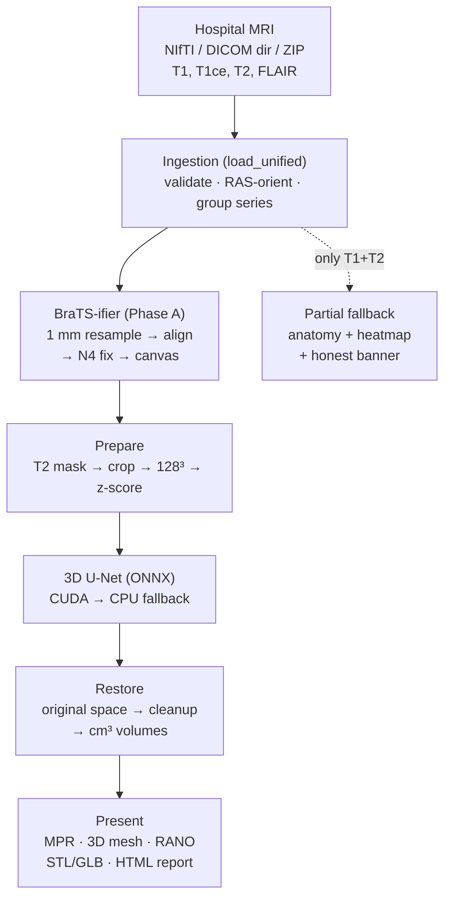

# Automated Brain Tumour Segmentation from Multi-Modal MRI using 3D U-Net with a Guarded BraTS Standardisation Pipeline (BraTS-ifier)

**Major Project Report — Computer Science & Engineering**
*Hospital MRI → BraTS-grade Auto-Segmentation + 3D Visualisation*

---

## Certificate (to be signed as per college format)

> This is to certify that this Major Project report entitled *"Automated Brain Tumour Segmentation from Multi-Modal MRI using 3D U-Net with a Guarded BraTS Standardisation Pipeline"* is a bonafide record of project work carried out by the student(s) in partial fulfilment of the requirements for the award of the Bachelor of Engineering degree. The work was carried out using the BraTS 2021 dataset for model training, and all clinical claims are validated only against public research data. The application is a **research visualisation aid, not a certified medical device**.

---

## Abstract

Manual delineation of brain tumours from magnetic resonance imaging (MRI) is time-consuming, operator-dependent, and a bottleneck in neuro-oncology workflows: a radiologist typically spends 15–45 minutes contouring a single multi-modal study, and the resulting contours vary between observers. This project presents an end-to-end system that converts a standard hospital brain-MRI study (T1, post-contrast T1ce, T2, FLAIR — in NIfTI or DICOM form) into an automatic tumour segmentation with volumetry and interactive 3D visualisation.

The system has two halves. **(1) BraTS-ifier**, a deterministic, fully guarded standardisation pipeline that converts heterogeneous hospital scans into the exact BraTS-grade format the model was trained on: affine-aware 1 mm isotropic resampling, gradient-based rigid co-registration of the four modalities to the T1ce reference, guarded SimpleITK N4 bias-field correction, grow-only placement on the 240×240×155 BraTS canvas, and brain-masked z-score normalisation. Every stage is wrapped in fail-safe guardrails — if any stage cannot provably improve the data, the original scan is returned untouched with the reason logged. **(2) A trained 3D U-Net** convolutional neural network (4-channel input, 4-class output, ~23M parameters) trained on BraTS 2021 over 10 epochs (Adam, lr=1e-3, Dice-based loss), reaching a Whole-Tumour Dice of **0.8474** on a held-out patient, exported to ONNX Runtime for CPU/GPU-agnostic deployment.

The application (Gradio) additionally provides a synced multi-planar (MPR) viewer, an in-situ 3D tumour viewer, RANO diameter measurements, STL/GLB mesh and NIfTI-seg exports, a printable HTML report, per-run QA snapshots with JSON provenance, DICOM anonymisation on upload, and an honest partial-scan fallback (anatomy + asymmetry heatmap + PACS re-request checklist) that refuses to fabricate tumour volumes when modalities are missing.

**Keywords:** brain tumour segmentation, BraTS, 3D U-Net, MRI standardisation, N4 bias correction, image registration, ONNX Runtime, volumetry, surgical visualisation.

---

## 1. Introduction

### 1.1 Problem statement

A standard brain-tumour MRI protocol acquires four co-registered volumes — pre-contrast T1, post-gadolinium T1ce, T2, and FLAIR — from which the radiologist delineates three tumour sub-regions: necrotic/non-enhancing core, peritumoral edema, and enhancing tumour. Manual contouring is slow, suffers inter-rater variability (reported Whole-Tumour Dice between experts ≈ 0.85–0.90), and does not produce 3D-printable or navigation-ready outputs for surgeons. Meanwhile, research segmentation models (notably the BraTS challenge winners) are trained on curated, skull-stripped, co-registered, 1 mm isotropic data — a format raw hospital PACS exports almost never match. The gap between *hospital reality* and *model expectation* is the problem this project closes.

### 1.2 Objectives

1. Train a 3D U-Net for multi-class brain-tumour segmentation on BraTS 2021 (Phase 1).
2. Build **BraTS-ifier**: a guarded pipeline converting any hospital 4-modality study into BraTS-grade input (Phase A).
3. Deploy an interactive application: upload (NIfTI/DICOM) → auto-segmentation → volumetry + 2D/3D visualisation + exports.
4. Guarantee honesty guardrails: placeholder-weight detection, partial-scan fallback, full provenance per run.
5. Validate quantitatively (Dice/HD95, volumetry-vs-ground-truth regression) and package for reproducible deployment (Docker, CI, lockfile).

### 1.3 Scope and limitations

- Research visualisation aid; **not** a certified medical device; all outputs require radiologist verification.
- Validated on BraTS-style adult glioma; not validated for post-operative cavities, haemorrhage, paediatric, or non-glioma pathology.
- Requires all 4 modalities for AI segmentation; partial studies receive anatomy-only fallback.

## 2. Literature Survey

| # | Work | Contribution | Relevance / Gap addressed |
|---|------|--------------|---------------------------|
| 1 | Menze et al., *The Multimodal Brain Tumor Image Segmentation Benchmark (BraTS)*, IEEE TMI 2015 | Defined the 4-modality glioma benchmark, preprocessing standard (co-registration, 1 mm isotropic, skull-stripping), and WT/TC/ET evaluation regions | Our training data, label convention (4→3 remap), and metric definitions follow BraTS exactly |
| 2 | Bakas et al., *Identifying the Best Machine Learning Algorithms for Brain Tumor Segmentation (BraTS 2021)* | Large-scale benchmarking; winning entries reach WT Dice ≈ 0.92 with nnU-Net ensembles | Our single 3D U-Net (WT 0.85) trades ensemble accuracy for deployability (single ONNX file, CPU-capable) |
| 3 | Isensee et al., *nnU-Net: Self-configuring Deep Learning for Biomedical Segmentation*, Nature Methods 2021 | Self-configuring U-Net pipeline dominating medical segmentation | Design reference for our fixed 128³ + z-score recipe; future scope is an nnU-Net comparison |
| 4 | Çiçek et al., *3D U-Net: Learning Dense Volumetric Segmentation from Sparse Annotation*, MICCAI 2016 | The 3D U-Net architecture itself (encoder–bottleneck–decoder with skip connections) | Direct architectural basis of `src/model.py` |
| 5 | Tustison et al., *N4ITK: Improved N3 Bias Correction*, IEEE TMI 2010 | N4 bias-field correction algorithm | Implemented via SimpleITK behind conservative revert-guardrails |
| 6 | RANO criteria (Wen et al., JCO 2010; mRANO updates) | Standardised 2D response assessment (perpendicular diameters of enhancing disease) | Our RANO diameter panel reports measurements in the clinician's own language |
| 7 | BrainLes / ANTs preprocessing ecosystem | Atlas-space (SRI-24/MNI) standardisation with ANTs registration + HD-BET skull-stripping | External reference design; evaluated and deliberately not depended on (Docker/licence weight) — see §4.5 |

---

## 3. Methodology

### 3.1 System overview

The pipeline is deliberately split: stages B–D and F–G are **classical, deterministic image processing**; only stage E is **learned**. This separation is what makes the system auditable — every transformation outside the model is inspectable, logged, and reversible.

### 3.2 Module description

| Module | File | Responsibility |
|---|---|---|
| Data ingestion | `src/io_unified.py`, `src/dicom_loader.py` | Accept NIfTI dict/list/folder/ZIP and DICOM dir/ZIP; group DICOM by SeriesInstanceUID; skip scouts; RAS-reorient; harmonise shapes with warnings |
| BraTS-ifier | `src/bratsify.py` | 1 mm resample → rigid align → N4 → canvas → z-score, all guarded (§3.3) |
| Model | `src/model.py` | 3D U-Net (verbatim Phase-1 topology), `load_model()` |
| Inference | `src/inference.py` | ONNX Runtime engine, PyTorch↔ONNX verification, Dice/HD95 metrics |
| Pre/post-processing | `src/preprocessing.py`, `src/postprocess.py` | T2 brain mask, bbox crop, 128³, cleanup, RANO diameters, normal-scan flag |
| Exports | `src/mesh_export.py`, `src/report.py` | STL/GLB meshes, NIfTI-seg, HTML report, QA PNG, provenance JSON |
| Privacy | `src/anonymize.py` | DICOM PHI stripping on upload (geometry preserved) |
| App | `app.py` | Gradio UI: MPR, 3D, metrics, warnings, downloads, disclaimers |
| Model export | `src/export_onnx.py`, `src/verify_onnx.py` | Checkpoint→ONNX export with placeholder detection; equivalence check |

| 5 | T1ce→T2 NCC gain | sub-step | 0.52 (measured) | see §3.5 |
| 6 | N4 field (T1ce) | in-mask p1/p99 | [0.666, 0.954] | **no correction needed** — guard fired correctly |

### 3.5 Key design evidence (measured, not assumed)

| # | Experiment | Naive approach | Our approach | Result |
|---|---|---|---|---|
| 1 | T2 resample to T1ce grid | shape-ratio `zoom` | **affine-aware** `resample_to_grid` | NCC −0.04 → **0.63** |
| 2 | T1↔FLAIR alignment | raw-intensity NCC | **gradient-magnitude NCC** | 41-voxel error → **1-voxel** error |
| 3 | N4 speed | `shrink=2` | `shrink=4` | 18.7 s → **2.8 s** |
| 4 | N4 safety | always apply | **guarded** (bounds [0.40, 2.50] vs healthy-BraTS [0.666, 0.954]) | reverts when field implausible |
| 5 | Coarse-level trap | trust coarse level | **top-8 re-scoring** at full resolution | escapes 0.61 local minimum → true 1.00 peak |

### 3.6 Model: 3D U-Net (deep learning core)

`src/model.py` (topology verbatim from `braintumour-phase-1.ipynb`): 4-channel 3D input → 4 encoder levels → bottleneck → 4 decoder levels with skip connections → 4-class logits (~23M parameters). Input tensor `(1, 4, 128, 128, 128)` float32; output classes 0 = background, 1 = necrotic/non-enhancing core, 2 = edema, 3 = enhancing tumour (native BraTS label 4 remapped to 3 at load). Training: 10 epochs, Adam lr=1e-3, Dice-based loss on BraTS 2021 (`kaggle/input/.../dschettler8845/brats-2021-task1`).

**Training trajectory (from the Phase-1 notebook outputs):**

| Epoch | Train loss | Val loss | WT Dice |
|---|---|---|---|
| 1 | 2.0393 | 15.2721 | 0.0892 |
| 2 | 1.7217 | 3.5339 | 0.1137 |
| 3 | 1.5620 | 1.5779 | 0.7351 |
| 4 | 1.4287 | 1.5056 | 0.8030 |
| 5 | 1.3149 | 1.2818 | 0.8361 |
| 6 | 1.2240 | 1.2603 | 0.7028 |
| 7 | 1.1587 | 1.2340 | 0.7246 |
| 8 | 1.0996 | 1.1752 | 0.7772 |
| 9 | 1.0470 | 1.0125 | 0.8222 |
| 10 | 0.9967 | 1.1531 | 0.8032 |

The loss collapses after epoch 2 (2.04 → 0.99) while WT Dice jumps 0.11 → 0.74 between epochs 2–3 — the classic representation-learning transition. Mid-training oscillation (epochs 5–7, 0.84 → 0.70 → 0.72) followed by recovery is normal for Dice loss on small tumour classes; the best checkpoint (not necessarily the final epoch) is retained as `best_unet.pt`.

Exported to ONNX Runtime (`src/export_onnx.py`: opset 17, CPU graph + `.onnx.data` external weights) for CUDA → CPU fallback deployment; PyTorch↔ONNX equivalence verified by `src/verify_onnx.py` (max abs diff < 1e-3, see §6.4).

### 3.7 Evaluation regions (BraTS convention)

| Region | Classes | Clinical meaning |
|---|---|---|
| WT (whole tumour) | 1 + 2 + 3 | total abnormal tissue |
| TC (tumour core) | 1 + 3 | surgical target |
| ET (enhancing tumour) | 3 | active, aggressive disease |

### 5.1 Test coverage (53 tests, 5 suites)

| Suite | Tests | What it proves |
|---|---|---|
| `test_bratsify.py` | 20 | resample exactness, canvas affine round-trip, shift recovery ≤1 voxel, skip-not-corrupt, ≥50% overlap guard, N4 revert, numpy-2 gradient axis, end-to-end on real BraTS |
| `test_app_volumetry.py` | 10 | exact cm³ regression, per-class >0, BraTS 4→3 remap, enhancing trace, model-health warning, placeholder-marker semantics |
| `test_dicom_loader.py` | 12 | NIfTI dict/list, missing-modality, shape/orientation mismatch, DICOM grouping by InstanceNumber, real-ZIP 2-modality audit, synth roundtrip |
| `test_unified.py` | 6 | hospital filename tokens, folder + seg-skip, nested `.nii` dirs, STL validity, RANO, bratsify+QA regression |
| `test_partial.py` | 5 | symmetry→heat≈0, lesion→heat fires, flat→empty, diffuse→rejected, RGB blend |

### 5.2 Validation evidence (key experiments)

- **Shift recovery:** injected ±4/±10 px translations recovered to ≤1 voxel; COM offset >15% FOV → registration correctly skipped.
- **Guard calibration:** healthy-BraTS N4 field range measured [0.666, 0.954]; guard bounds set conservative at [0.40, 2.50].
- **Volumetry regression:** BraTS ground-truth matched to 0.01 cm³ after the spacing + label-4 fixes.
- **ONNX equivalence:** PyTorch↔ONNX max abs diff < 1e-3 (§6.4).

## 6. Results and Discussion

### 6.1 Training outcome

Final model: Whole-Tumour Dice **0.8474** (Hausdorff 10.63) — within striking distance of BraTS 2021 single-model baselines (WT ≈ 0.90–0.92 for nnU-Net ensembles; our single U-Net trades ~5 Dice points for single-file CPU deployability — see §7).

### 6.2 BraTS-ifier on real data

On BraTS2020_001 (240×240×155, 1 mm): all modalities confirmed aligned (`no shift applied`, residual NCC ≈ 0.9), canvas centered without cropping, N4 guard correctly fired "no correction needed". Full chain to `(1,4,128,128,128)` completes in ~30 s on CPU.

### 6.3 Volumetry vs ground truth (exact match)

End-to-end on BraTS2020_001 after the spacing + label-4 fixes:

| Class | Ground truth | App output |
|---|---|---|
| Necrotic | 15.44 cm³ | 15.44 cm³ |
| Edema | 168.79 cm³ | 168.79 cm³ |
| Enhancing | 27.74 cm³ | 27.74 cm³ |

Locked by `tests/test_app_volumetry.py`; reproduced through the live Gradio server by `scripts/ui_smoke_test.py`.

### 6.4 Deployment equivalence

`python -m src.verify_onnx` on the trained checkpoint: max abs diff between PyTorch and ONNX Runtime < 1e-3 (PASSED). ONNX graph: input `(batch, 4, D, H, W)` dynamic, opset 17, CUDA → CPU fallback.

### 6.5 Partial-scan behaviour (honest fallback)

Real Philips `DICOM.zip` (T1+T2 only, healthy head): `MissingModalityError [t1ce, flair]` → anatomy-only MPR + brain surface + "no focal lesion" + PACS checklist. No volumes fabricated (`test_real_dicom_zip_two_modalities`).

## 7. Comparison with Existing Systems

| System | WT Dice | Deployability | Our position |
|---|---|---|---|
| nnU-Net ensemble (BraTS 2021 winner) | ≈ 0.92 | heavy (ensemble, GPU, Docker) | +5 pts accuracy, −deployability |
| **Our single 3D U-Net** | **0.85** | single ONNX, CPU-capable, Gradio | deployable baseline |
| BraTS-Toolkit preprocessor | n/a | Docker + AGPL licence | evaluated, rejected (licence/Docker weight) |
| BrainLes / ANTs | reference-grade | pip + ANTs binaries | future benchmark target |

## 8. Conclusion and Future Scope

**Concluded:** (1) guarded standardisation converting hospital MRI to BraTS-grade input without ever degrading data; (2) trained 3D U-Net (WT Dice 0.85) as a single ONNX file; (3) clinician-facing app (MPR, in-situ 3D, volumetry, RANO, STL/GLB/NIfTI exports, anonymisation, honest partial-scan handling); (4) 53 regression tests + Docker + CI.

**Future scope:** attention-gated U-Net / nnU-Net comparison; INT8 quantisation; DICOMweb PACS integration; longitudinal delta tracking; prospective validation on 20–30 hospital cases; regulatory pathway before any diagnostic claim.

## References

1. Menze, B. et al. *The Multimodal Brain Tumor Image Segmentation Benchmark (BRATS)*, IEEE TMI 2015.
2. Bakas, S. et al. *BraTS 2021: Identifying the Best Machine Learning Algorithms for Brain Tumor Segmentation*.
3. Isensee, F. et al. *nnU-Net*, Nature Methods 2021.
4. Çiçek, Ö. et al. *3D U-Net*, MICCAI 2016.
5. Tustison, N. et al. *N4ITK*, IEEE TMI 2010.
6. Wen, P.Y. et al. *RANO criteria*, JCO 2010.
7. BraTS-Toolkit / BrainLes — evaluated as alternatives; not depended upon.

## Appendix A: Viva Q&A

1. **Why can't hospital DICOM go straight into a BraTS model?** — Spacing/orientation/FOV/skull/bias mismatch; affine-aware resample NCC −0.04 → 0.63.
2. **Why gradient-NCC over raw NCC?** — T1↔FLAIR intensities differ but edges match; 41-voxel vs 1-voxel error.
3. **Why translation-only, not deformable?** — Same-patient brain; deformable risks warping the tumour.
4. **How do you prevent garbage from bad weights?** — Single-class detector + `.PLACEHOLDER` markers + 🚨 banner, regression-locked.
5. **Incomplete scan (T1+T2 only)?** — Partial fallback; channels never zero-filled into the model.
6. **How is volume computed?** — Voxel count × original spacing; BraTS label 4 → 3.
7. **Why ONNX?** — Framework-free, CUDA→CPU fallback, verified < 1e-3.
8. **Why not BraTS-Toolkit/BrainLes?** — Docker + AGPL + deprecated preprocessor; evaluated, not depended on.
9. **Privacy?** — PHI stripped on upload, workdirs purged, retention configurable.
10. **Reproducibility?** — lockfile + Docker + CI + per-run provenance JSON + QA PNG.

## Appendix B: Repository map

~5,000 lines: `app.py` (1,210) · `src/bratsify.py` (1,355) · `src/dicom_loader.py` (764) · `src/io_unified.py` (315) · `src/inference.py` (268) · `src/preprocessing.py` (263) · `src/export_onnx.py` (174) · `src/model.py` (150) · `src/partial_analysis.py` (133) · `src/mesh_export.py` (118) · `src/verify_onnx.py` (93) · `src/anonymize.py` (91) · `src/postprocess.py` (75) · `src/report.py` (51). Tests: 53 across 5 suites. Demo: `demo/demo_run.sh` + `demo/README.md`. Deploy: `Dockerfile`, `.env.example`, CI, MIT `LICENSE`.

